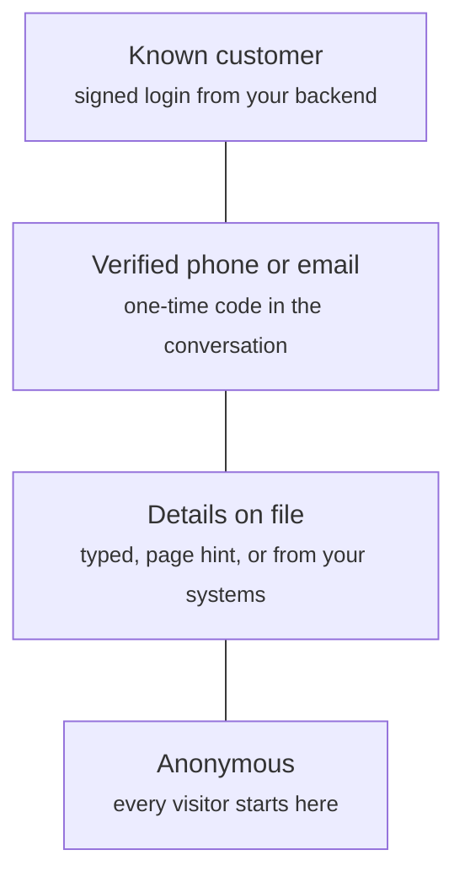

Crossword keeps a profile for every shopper who opens the widget. How much Crossword trusts it depends on how its details arrived. Only a signed login from your backend makes a shopper a known customer and opens customer data such as orders.

## The four levels

Each level adds trust to the one below it. A shopper moves up with stronger proof.



| Level | How it is set | What it unlocks | Page |
| ----- | ------------- | --------------- | ---- |
| Anonymous | Automatically, when the widget first loads for a visitor | A profile that keeps the same conversation on return visits | This section |
| Details on file | The shopper types them, your page hints them, or your systems create or import them | Personalized replies, such as greeting the shopper by name | [Details from your site](#details-from-your-site) |
| Verified phone or email | The shopper enters a one-time code sent to that phone or email | Proof the shopper holds that phone or mailbox. It is not an identity | [Phone and email verification](#phone-and-email-verification) |
| Known customer | Your backend requests a signed token and passes it to the widget | Customer data such as orders, and the logged-in entry point condition | [Signed login](#signed-login) |

Every visitor starts anonymous. The widget remembers the anonymous profile in the browser, so a returning visitor keeps it until they log in or log out.

## Which details win

Crossword tracks where each detail came from and never lets a less trusted source overwrite a more trusted one. From lowest to highest trust:

1. Anonymous
2. Page hint
3. Typed by the shopper
4. From your systems
5. Signed login

For example, a typed email never replaces one you imported, but an email from a signed login replaces both. Changing a phone or email clears its verification, so the new value needs a new code.

## Signed login

A signed login is the only way to make a shopper a known customer. The shopper stays a known customer on later logins.

<Steps>
  <Step title="Create the customer">
    The customer must exist before you request a token. Read [From your systems](#from-your-systems).
  </Step>
  <Step title="Request a token from your backend">
    When the shopper signs in to your store, your server calls the token endpoint.
  </Step>
  <Step title="Pass the token to the widget">
    Your page passes the token on the script tag or with `login()`.
  </Step>
  <Step title="The widget signs the shopper in">
    Crossword checks the token and treats the shopper as a known customer.
  </Step>
</Steps>

### Request a token

Call this endpoint from your server, never from the browser.

```
POST /api/workspaces/{workspace_id}/contacts/{user_id}/tokens
```

Authenticate with a workspace API key as a Bearer token. A dashboard session does not work. The `user_id` must belong to an existing customer. The endpoint allows 60 requests per minute per workspace.

Both body fields are optional.

| Field | Type | Description |
| ----- | ---- | ----------- |
| `ttl_seconds` | integer | How long the token stays valid, from 60 to 86400 seconds. Defaults to 3600. |
| `claims.email` | string | The customer's email. |
| `claims.display_name` | string | The name Crossword shows and uses for the customer. |
| `claims.phone` | string | The customer's phone number. |
| `claims.locale` | string | The customer's locale, such as `en-US`. |
| `claims.timezone` | string | The customer's time zone, such as `America/New_York`. |
| `claims.metadata` | object | Extra fields, merged into the customer's existing metadata. |

Claims update the profile at sign-in and replace details from every other source.

```bash
curl -X POST "https://api.crossword.ai/api/workspaces/<workspace_id>/contacts/<user_id>/tokens" \
  -H "Authorization: Bearer <workspace API key>" \
  -H "Content-Type: application/json" \
  -d '{
    "ttl_seconds": 3600,
    "claims": {
      "email": "shopper@example.com",
      "display_name": "Jordan",
      "locale": "en-US",
      "timezone": "America/New_York",
      "metadata": { "tier": "gold" }
    }
  }'
```

```json
{
  "token": "<token>",
  "kid": "<signing key id>",
  "algorithm": "<signing algorithm>",
  "exp": 1760000000,
  "iat": 1759996400
}
```

| Field | Description |
| ----- | ----------- |
| `token` | The token to pass to the widget. |
| `kid` | The ID of the signing key that signed the token. |
| `algorithm` | The signing algorithm. |
| `exp` | When the token expires, in Unix seconds. |
| `iat` | When the token was issued, in Unix seconds. |

### Pass the token to the widget

If the shopper is already signed in when the page loads, add `data-auth-token` to the script tag from your installation snippet. `data-workspace-key` holds your channel key. The widget signs the shopper in from its first request, so no anonymous profile is created.

```html
<script
  src="<widget script URL>"
  data-workspace-key="<channel key>"
  data-auth-token="<token>">
</script>
```

If the shopper signs in after the page loads, pass the token to `login()`.

```js
await window.CrosswordAgent.login(token);
```

When `login()` succeeds, the widget switches from the anonymous profile to the signed-in one, clears the anonymous chat from view, and loads the shopper's latest conversation. The shopper stays signed in on later sessions.

### Sign out

Call `logout()` when the shopper signs out of your store.

```js
window.CrosswordAgent.logout();
```

The widget returns to a fresh anonymous visitor with a new conversation. The profile stays a known customer for the next login.

### Signing keys

Each workspace has a signing key pair. Crossword signs every token with the workspace's current private key.

- **Crossword keeps the private key.** Only the public key is shown. Only the Crossword API issues tokens, so no one can create one without your workspace API key.
- **You can rotate the key.** The previous key keeps working during rotation, so issued tokens stay valid.
- **Managing keys needs permission.** A team member needs the signing key permission.

### What it unlocks

- **Customer data.** The Agent can use the shopper's orders and history. Read [Customer memory](/agents/customer-memory).
- **The logged-in condition.** An entry point or rule that tests for a logged-in shopper matches only after a signed login, so you can send signed-in shoppers to a Journey such as Support. Read [Rules](/orchestration/rules).

## Phone and email verification

Verification confirms that a shopper can receive messages at a phone number or email.

<Warning>
Verification does not sign the shopper in. It proves the shopper holds a phone or mailbox, not who they are, so customer data such as orders stays closed. Use a [signed login](#signed-login) instead.
</Warning>

### Set up verification

Create one verification setup for each field, phone or email. The setup names who sends and checks the code.

| Sender | Who sends the code | Who checks the code |
| ------ | ------------------ | ------------------- |
| Crossword by email | Crossword, by email | Crossword |
| Crossword by SMS | Crossword, by SMS | Crossword |
| Your own system | Your send webhook | Your check webhook |

A [form](/components/interactive/form) uses the setup in its code step. The form decides when the code field appears, and the setup decides how the code is sent and checked.

### What the shopper sees

<Steps>
  <Step title="The shopper enters a phone or email">
    They type it in a form step. Crossword saves it as a detail typed by the shopper.
  </Step>
  <Step title="Crossword sends a code">
    The code goes to the value saved on the profile, never to a value supplied directly by the browser.
  </Step>
  <Step title="The shopper enters the code">
    If the code is wrong or expired, or the shopper is out of tries, the message shows on the code field.
  </Step>
  <Step title="The phone or email is verified">
    A correct code marks the value as verified on the profile.
  </Step>
</Steps>

### Limits

These limits protect your shoppers and your sending costs. A destination is one phone number or email.

| Limit | Default | Configurable |
| ----- | ------- | ------------ |
| Code length | 6 digits | No |
| Code valid for | 10 minutes | No |
| Wrong tries | 8 per conversation | Yes |
| Resends | 5 per conversation | Yes |
| Codes per destination | 10 per day | Yes |
| Sends per visitor IP address | 30 per day | Yes |
| Sends per workspace | 200 per day | Yes |

### Telling the Agent

A setup can tell the Agent when a shopper verifies. Turn this on when the Agent needs the verified value to continue, such as booking a callback. The Agent replies as soon as the code is accepted, without the shopper typing anything else.

<Note>
The Agent can trust that the shopper holds that phone or mailbox, but not that they are the customer on file. Customer data stays closed until a [signed login](#signed-login).
</Note>

## Details from your site

A name, email, or phone on the profile lets the Agent personalize replies. These details come from your page, the shopper, or your systems. None of them signs the shopper in.

### From the page

A page hint passes details your page already knows. Page hints are off by default, and you turn them on for each channel.

Call `identify()` with at least one field.

```js
await window.CrosswordAgent.identify({
  email: "shopper@example.com",
  name: "Jordan",
  phone: "+15555550123"
});
```

| Field | Rule |
| ----- | ---- |
| `email` | Optional. Must be a valid email address. |
| `name` | Optional. 1 to 200 characters. |
| `phone` | Optional. |

If the call fails, for example because page hints are off or a value is not valid, the widget ignores it silently.

Instead, the channel can read a cookie your site already sets, named in the channel settings. A value that contains `@` is treated as an email, and any other value as a name. You can name a second cookie for the shopper's name. The widget reads both when it starts.

A page hint only personalizes, such as greeting the shopper by name. It:

- Never verifies a phone or email.
- Never merges two profiles into one.
- Does nothing to a signed-in shopper.
- Never overwrites details typed by the shopper, from your systems, or from a signed login.

### Session context is not identity

The widget's `setContext()` is for session context. It does not change the shopper's profile and verifies nothing.

<Warning>
Do not use `setContext()` or a page hint to tell Crossword a shopper is logged in. Any page script can fake a "logged in" flag, so Crossword never treats it as proof. The logged-in condition and customer data rely on a [signed login](#signed-login).
</Warning>

### Typed by the shopper

| Path | How it happens | When it is available |
| ---- | -------------- | -------------------- |
| [Form](/components/interactive/form) step | The shopper submits a form step that collects contact details | When the form is on the channel |
| The Agent during the chat | The Agent learns and saves the details | When contact saving is on for the channel and the Agent |
| Contact form card | The shopper presses **Submit** on the card | When contact saving is on for the channel and the Agent. Limited to 5 submits per 10 minutes per IP address |

A typed phone or email is not verified. To confirm it, add [verification](#phone-and-email-verification) to the form.

### From your systems

Your systems can create and update customers. These details still do not make a shopper a known customer.

- **Create a customer** with the API or in the dashboard, using your own ID as the `user_id`. The request fails if that `user_id` is taken. This is the first step of a [signed login](#signed-login), since tokens are only issued for existing customers.
- **Edit a customer** in the dashboard.
- **Import a CSV** to create or update customers in bulk. Rows match on `user_id`: a new one creates a customer, and an existing one updates it. An import never overwrites details from a signed login.

The CSV takes these columns.

| Column | What it holds |
| ------ | ------------- |
| `user_id` | Your ID for the customer. Required. |
| `display_name` | The customer's name. |
| `email` | The customer's email. |
| `phone` | The customer's phone number. |
| `avatar_url` | A link to the customer's profile image. |
| `locale` | The customer's locale, such as `en-US`. |
| `timezone` | The customer's time zone, such as `America/New_York`. |
| `metadata` | Extra fields about the customer. |

## Related

<CardGroup cols={2}>
  <Card title="Form" href="/components/interactive/form" />
  <Card title="Customer memory" href="/agents/customer-memory" />
  <Card title="Rules" href="/orchestration/rules" />
  <Card title="Channels and experiences" href="/orchestration/channels-and-experiences" />
</CardGroup>
