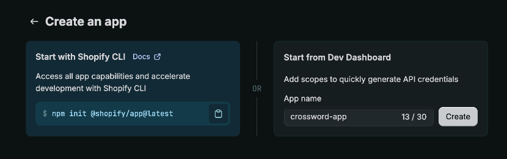
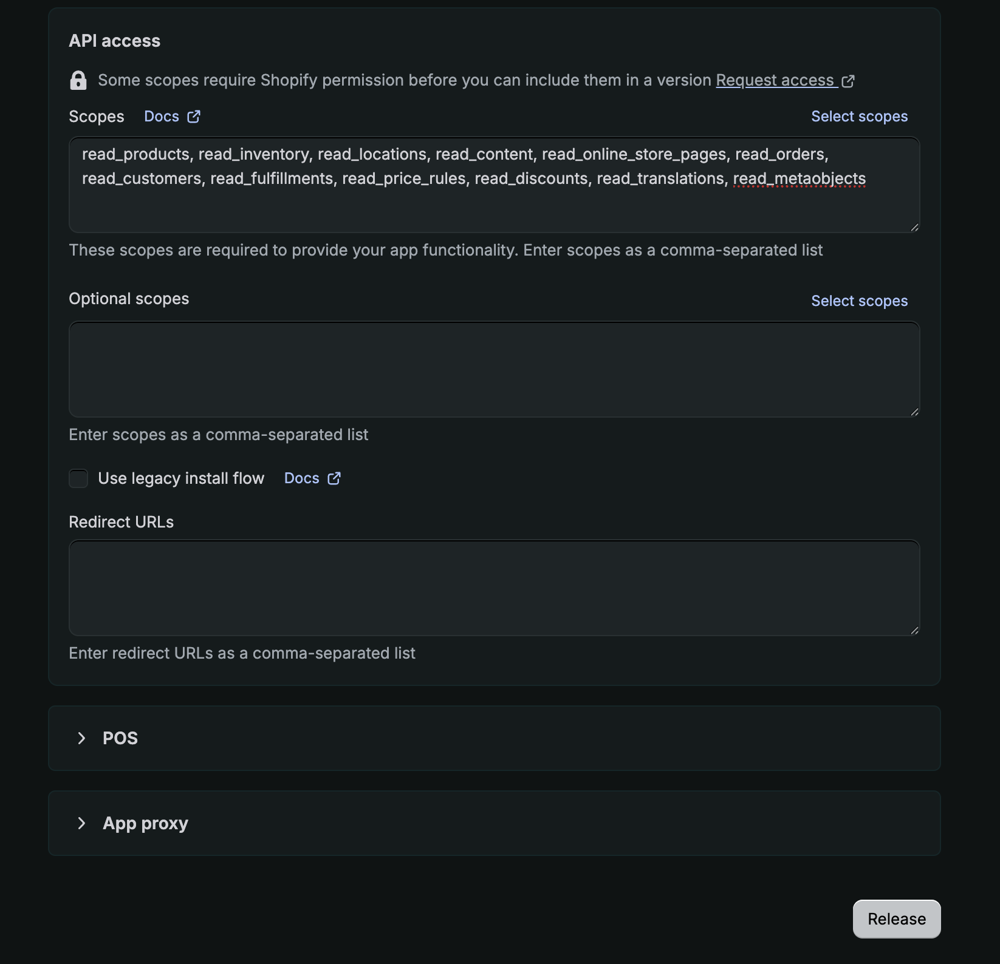
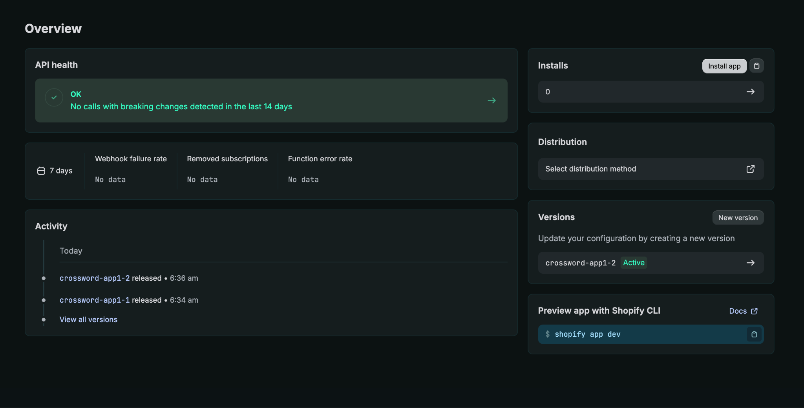
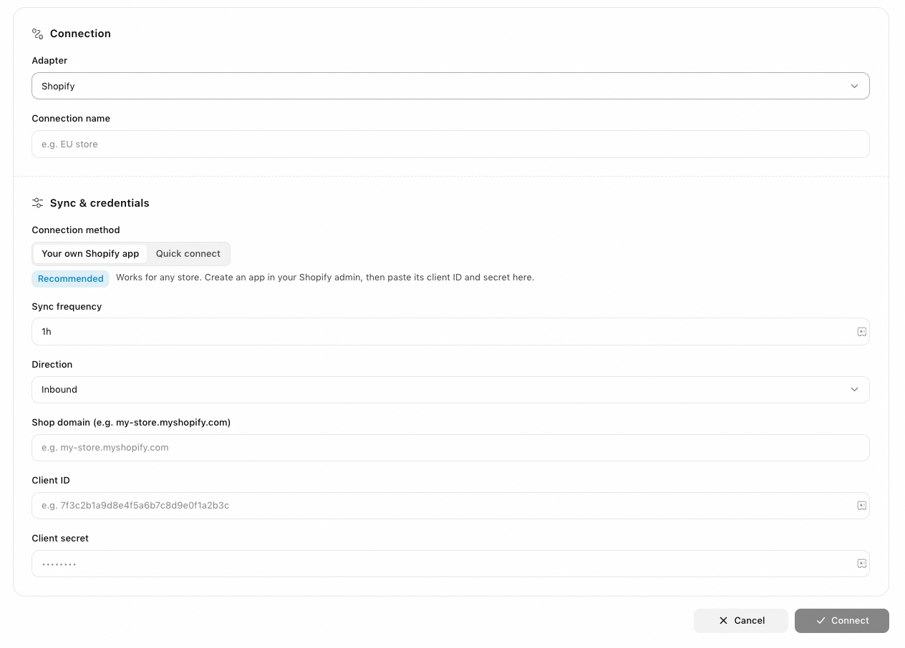

To connect your store, you create a small app inside your own Shopify admin, then paste two values from it into Crossword. Every permission Crossword asks for is read-only, so it can never change anything in your store.

## Before you start

You can do this if you are the store owner or have the **App developer** role. On Shopify Plus, a custom role with **Build and manage apps** also works. Collaborator accounts, such as agencies and freelancers, cannot access the Dev Dashboard.

## Connect your store

<Steps>
  <Step title="Open the Dev Dashboard">
    Open the [Shopify Dev Dashboard](https://dev.shopify.com/dashboard/) and sign in.

    You can also get there from your Shopify admin: go to **Settings > [Apps](https://admin.shopify.com/settings/apps) > Develop apps > Build apps in Dev Dashboard**.

    <Warning>
      Check the organization name at the top of the screen. If you also have a Shopify Partner account, you may land in the wrong organization. It must be the organization that owns your store, or the install fails.
    </Warning>
  </Step>
  <Step title="Create the app">
    Go to **Apps > Create app > Start from Dev Dashboard**. Name the app **Crossword**, then click **Create**.

    <Frame>
      
    </Frame>
  </Step>
  <Step title="Add the permissions and release">
    Open the **Versions** tab and leave the **App URL** as it is. Paste these twelve access scopes into **Scopes**:

    ```text wrap
    read_products, read_inventory, read_locations, read_content, read_online_store_pages, read_orders, read_customers, read_fulfillments, read_price_rules, read_discounts, read_translations, read_metaobjects
    ```

    Then click **Release**.

    <Warning>
      Releasing is not optional. The permissions do nothing until you click **Release**. If you skip it, the app still installs, but Crossword is refused every time it tries to read anything. This is the most common way the setup fails silently.
    </Warning>

    <Frame>
      
    </Frame>
  </Step>
  <Step title="Install the app">
    Go to **Home > Install app**, select your store, then click **Install**.

    <Frame>
      
    </Frame>
  </Step>
  <Step title="Copy your credentials">
    In the Dev Dashboard, open **Settings**. Under **Credentials**, copy the **Client ID** and the client secret, which the screen labels **Secret**.
  </Step>
  <Step title="Connect in Crossword">
    In the [Crossword dashboard](https://app.crossword.ai), open **Table** and click **Connectors** at the top right. Under **Adapter**, select **Shopify**. Keep **Your own Shopify app** as the connection method.

    Enter a **Connection name** and your **Shop domain**, such as `my-store.myshopify.com`. Paste the **Client ID** and **Client secret**, then click **Connect**.

    <Frame>
      
    </Frame>
  </Step>
</Steps>

That is the whole setup. You have nothing to renew afterwards, because Crossword requests short-lived keys from Shopify as it needs them.

To see your Agent on your store, read [Try Crossword on your store](/try-on-your-store).

## Good to know

- **Treat the client secret like a password.** Paste it straight into Crossword rather than sending it by email. You can revoke it at any time from the same **Settings** screen, or by uninstalling the app.
- **Order and customer answers depend on your Shopify plan.** On the Basic and Starter plans, Shopify does not make order and customer details available to apps like this one. Product, price, stock, and collection answers work on every plan. If you need order-related answers, tell your Crossword team and they will walk you through the extra step.
- **If you get stuck, send a screenshot.** Send your Crossword team a screenshot of what you are seeing. Never send the client secret.
